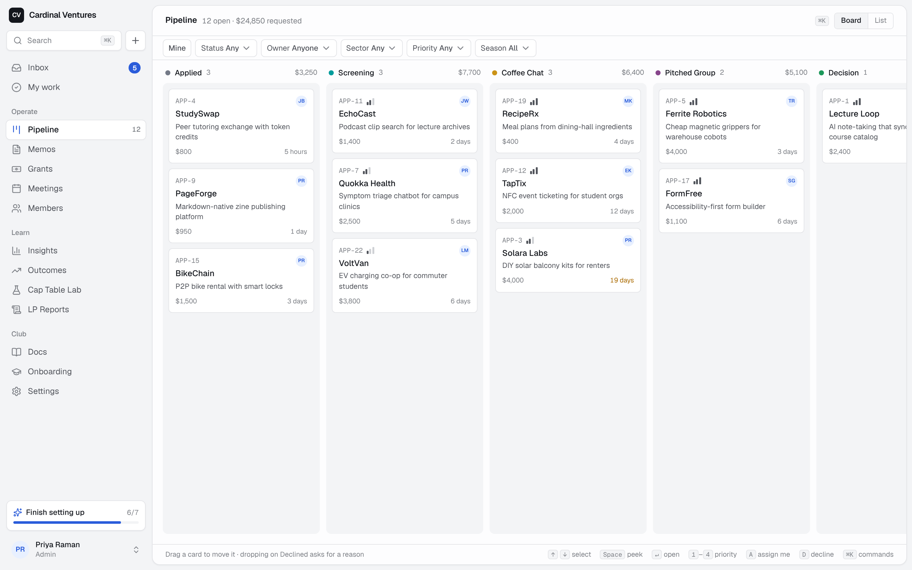
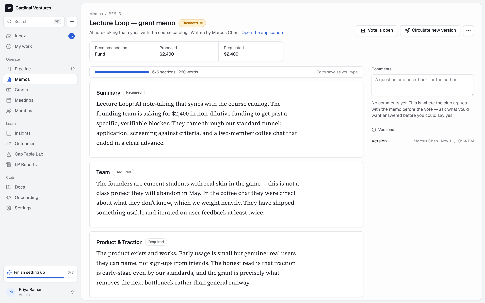
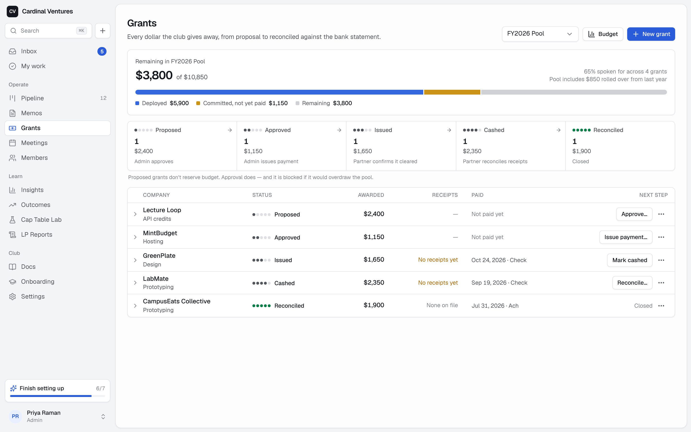
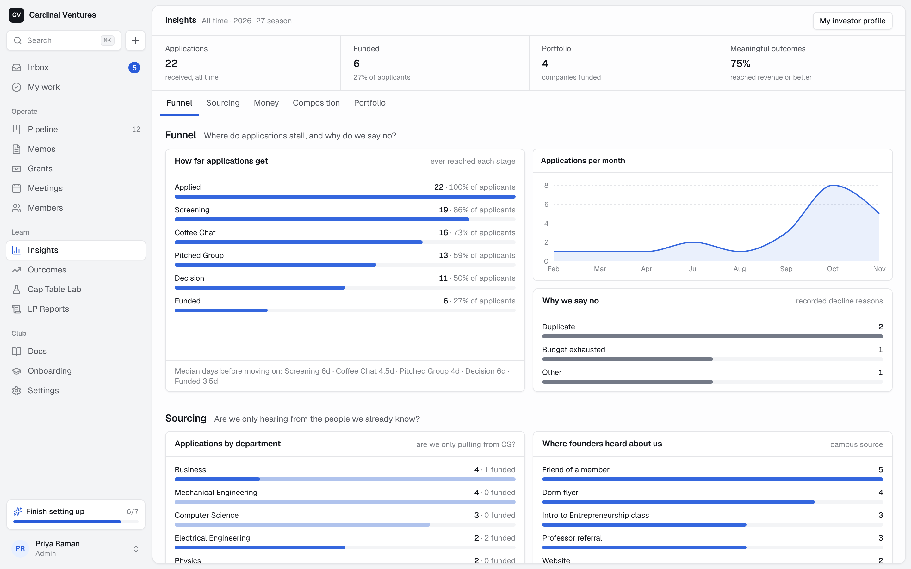
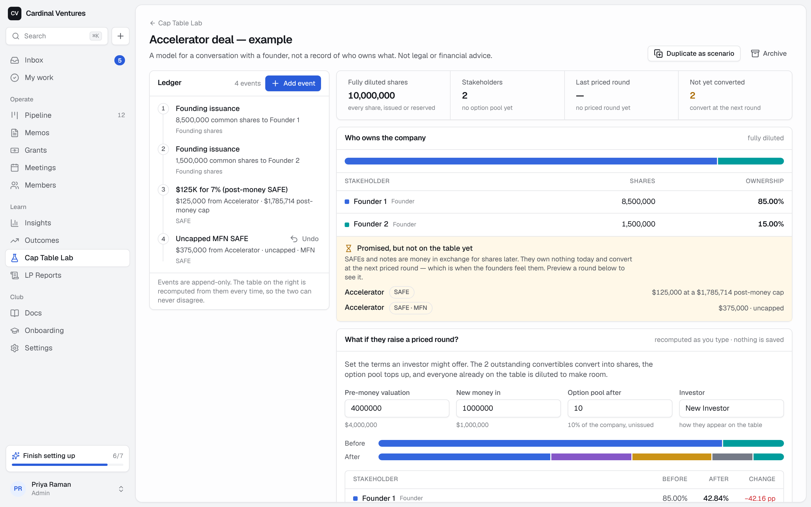

<div align="center">

# OpenVenture

**The open-source operating system for student-run venture funds and grant programs.**

Applications, screening, memos, blind IC votes, and budget-guarded grants — with the
discipline of a real fund and none of the spreadsheet sprawl.

[](https://github.com/BigJimThunder/OpenVenture/actions/workflows/ci.yml)
[](LICENSE)
[](https://nextjs.org)
[](https://www.typescriptlang.org)
[](https://neon.tech)

<picture>
  <source media="(prefers-color-scheme: dark)" srcset="docs/screenshots/pipeline-dark.png">
  
</picture>

</div>

## Why

College VC clubs run on a sprawl of Airtable, Notion, Google Sheets, Slack pings, and
Google Forms — and every spring the institutional memory graduates with the seniors.
OpenVenture replaces that sprawl with one application that owns the club's deal flow, its
written work, its people, and its money — and doubles as a training ground for the skills
venture firms actually expect.

Built for clubs that make **non-dilutive grants** to student founders (a ~$10k/year pool,
checks from $200–$4,000) but useful to any student investing group.

> Every screenshot on this page is the real app, rendered from the demo seed
> (`pnpm seed:demo`) — fictional companies, plausible numbers.

## What's inside

| Module | What it does |
|---|---|
| **Intake & pipeline** | A hosted application form (or your own, via a signed webhook) feeds a kanban: Applied → Screening → Coffee Chat → Pitched Group → Decision → Funded/Declined. Each application arrives with an owner and a duplicate check. Declines require a reason — that's what makes the annual retro real. |
| **Automations** | One daily job: vote reminders and auto-close, stage-deadline nudges, a Monday digest, quarterly grantee check-ins. No per-event email storms; everything is deduplicated. |
| **Memos & blind IC voting** | Templated memos with section versioning and comments; conviction voting that stays **hidden until reveal** — the cheapest anti-groupthink mechanism there is. |
| **Grants** | The pool, requests, approve → issue → reconcile, receipts, budget burn-down with an overdraw guard. |
| **Members, onboarding, meetings** | Roster, onboarding checklists, agenda builder, two-tap attendance, run mode, recaps, iCal feed. |
| **Insights** | Funnel conversion, sector & department mix, per-member sourcing attribution, decline reasons, outcome tiers, and per-member investor self-analysis. |
| **Cap Table Lab** | A dilution sandbox for advising grantees: pitch-comp SAFEs, "$125K for 7%" accelerator deals, pool shuffles — with "show your work" on every derived number. |
| **LP reports** | Quarterly letters generated from real data — deployment, pipeline, portfolio moves — plus GP commentary, print-ready for PDF. |
| **Enrichment & export** | One-click company enrichment from the founder's own website (optional Claude pass with an `ANTHROPIC_API_KEY`); full JSON/CSV export — your data is never locked in. |

## The work, not just the workflow

Memos are documents, not form fields — templated sections, versioned, commentable, and
tied back to the application they argue about.

<picture>
  <source media="(prefers-color-scheme: dark)" srcset="docs/screenshots/memo-dark.png">
  
</picture>

Votes are **blind by default**. Conviction scores and rationales stay sealed until the
round is revealed — enforced server-side, not by convention. Only `getVoteRoundResults()`
may read ballots pre-reveal.

## Money that reconciles

Every grant walks propose → approve → issue → reconcile, against a pool that knows its own
budget. Approvals are budget-guarded, so the club cannot overdraw the pool by accident.

<picture>
  <source media="(prefers-color-scheme: dark)" srcset="docs/screenshots/grants-dark.png">
  
</picture>

## The season, in numbers

The headline module. Funnel conversion, where applications actually come from, who sourced
what, and why the club said no.

<picture>
  <source media="(prefers-color-scheme: dark)" srcset="docs/screenshots/insights-dark.png">
  
</picture>

Self-reported demographics are **aggregate-only**, suppressed below a cell size of 5, with
no per-person display, no export, and no two-way cross-tabs. Small clubs can re-identify a
person from a chart, so the chart refuses.

## Cap Table Lab

A dilution sandbox for advising grantees — and a teaching tool. Every derived number
expands to the arithmetic that produced it.

<picture>
  <source media="(prefers-color-scheme: dark)" srcset="docs/screenshots/lab-dark.png">
  
</picture>

`src/lib/captable/engine.ts` is a pure function — no I/O, no floats, all `decimal.js` —
that folds an immutable event ledger into a cap table. It handles:

- **Post-money SAFEs** (YC mechanics: fixed `principal ÷ cap` ownership, pool increase excluded from their denominator)
- **Pre-money SAFEs** (original YC convention, sharing pool-shuffle dilution)
- **Notes** with accrued interest, **MFN** resolution, **discounts** (better-of pricing)
- Pool top-ups, splits, and transfers

Priced rounds are solved by bisection on a monotone residual, so it stays robust across the
piecewise kinks where instruments switch between cap and discount pricing — and it tells you
clearly when a pool target is mathematically unattainable.

```bash
pnpm test    # golden-fixture corpus: hand-computed worked examples + property tests
```

> **Disclaimer:** the Cap Table Lab is an educational modeling tool, not legal or financial
> advice. Verify against the company's own records before anyone signs anything.

## Deploy your own

**About ten minutes, no terminal.** You need a GitHub account; everything else is created
along the way, on free tiers.

[](https://vercel.com/new/clone?repository-url=https%3A%2F%2Fgithub.com%2FBigJimThunder%2FOpenVenture&project-name=openventure&repository-name=openventure&env=BETTER_AUTH_SECRET,CRON_SECRET,RESEND_API_KEY&envDescription=Two%20random%20strings%20you%20make%20up%2C%20and%20a%20free%20Resend%20key%20for%20sign-in%20emails.&envLink=https%3A%2F%2Fgithub.com%2FBigJimThunder%2FOpenVenture%23what-the-settings-mean&stores=%5B%7B%22type%22%3A%22integration%22%2C%22integrationSlug%22%3A%22neon%22%2C%22productSlug%22%3A%22neon%22%2C%22protocol%22%3A%22storage%22%7D%5D)

1. **Get a Resend key** (2 min). Sign up at [resend.com](https://resend.com) *with the email
   you will sign in to OpenVenture with*, then API Keys → Create. Copy the key.
2. **Click the button above.** Vercel copies this repository into your GitHub account,
   offers to create a free **Neon** Postgres database (accept it), and asks for three
   values — see the table below.
3. **Wait for the build** (about two minutes). It creates every database table on its own.
4. **Open your new site and sign in** with the same email you used for Resend. You'll get a
   link and a six-digit code. The first person to sign in sets up the club — name, budget,
   and whether to open the application form — and becomes its first admin.
5. **Follow the checklist** the app shows you next: invite members, review the pipeline,
   schedule a meeting.

**Want one-click upgrades later?** The button gives you an independent copy of the code.
If you would rather pull in new versions with a single click, **fork** this repository on
GitHub first, then in Vercel choose *Add New → Project*, import your fork, and enter the
same three values. Everything else is identical.

If the button doesn't offer a database (Vercel changes this flow from time to time): finish
the deploy, then in your Vercel project go to **Storage → Create Database → Neon**, connect
it to the project, and **Redeploy**.

### What the settings mean

| Setting | Needed? | What to put |
|---|---|---|
| `BETTER_AUTH_SECRET` | Yes | Any long random string (40+ characters). It keeps sign-ins secure. A password manager's generator is ideal. |
| `CRON_SECRET` | Yes | Another long random string. It lets Vercel — and only Vercel — trigger the daily reminders. |
| `RESEND_API_KEY` | Yes, in practice | The key from step 1. Without it nobody receives a sign-in email. |
| `DATABASE_URL` | Set for you | Added by the Neon integration. |
| `EMAIL_FROM` | Later | Once you verify your club's domain in Resend: `Your Club <grants@yourclub.org>`. Until then email only reaches the Resend account owner — fine for setting up, **required before you invite anyone**. |
| `BETTER_AUTH_URL` | With a custom domain | Your site's address, e.g. `https://grants.yourclub.org`. On a plain `*.vercel.app` address it is worked out automatically. |
| `ANTHROPIC_API_KEY` | Optional | Turns on AI drafts (summaries, memo help). Always drafts for a human to edit. |

Slack is optional too, and isn't an environment variable: paste an incoming-webhook URL in
**Settings → Intake** to get a ping for each new application.

Open **`/api/health`** on your site at any time. It lists what is and isn't connected,
without revealing any secrets.

**What it does on its own once deployed:** assigns each new application to the next member
in rotation, emails the founder a confirmation, flags likely duplicates, reminds voters the
day before a blind vote closes and closes it at the deadline, nudges owners when an
application stalls, sends a Monday digest, and reminds you to check in with grantees each
quarter. Each of these can be switched off in Settings → Automations.

Runs comfortably at **$0–15/month**: Vercel Hobby + Neon free tier + Resend free tier.
One club per deployment, self-hostable, no multi-tenant SaaS in the middle.

Handing the club to next year's officers? Read **[ADMIN_RUNBOOK.md](ADMIN_RUNBOOK.md)** — a
non-engineer's guide to invites, backups, upgrades, the annual handover checklist, and the
break-glass admin hatch.

### How founders apply

- **The hosted form.** Settings → Intake → turn on the application form and share
  `https://your-site/apply`. No account needed, works on a phone, spam-protected without
  any third-party service.
- **Your own form.** If the club's website already has one, POST its JSON to a signed
  endpoint instead (the secret is in Settings → Intake):

  ```
  POST /api/ingest/application
  x-openventure-signature: sha256=<HMAC-SHA256 of the raw body>
  ```

Both paths do the same thing: the application lands in the pipeline with an owner, the
founder hears back, and Slack gets a ping.

## Local development

```bash
pnpm install
cp .env.example .env.local   # set DATABASE_URL (any Postgres) and BETTER_AUTH_SECRET
pnpm db:migrate              # create or update the schema
pnpm dev                     # http://localhost:3000
```

Without a `RESEND_API_KEY`, sign-in links print to the server console. First sign-in walks
you through creating the club.

Want a club caught mid-season — fresh applications, a vote closing in two days, grants at
every stage (fictional companies only)?

```bash
DATABASE_URL=… pnpm seed:demo   # wipes the database first; refuses on a real club's data
```

**Schema changes.** The SQL files in `drizzle/` are the source of truth, and every deploy
applies them automatically (`pnpm build` runs `scripts/migrate.mjs` before `next build`).
To change the schema: edit `src/db/schema/*`, run `pnpm db:generate`, commit the new
migration. `pnpm db:push` is fine for throwaway local experiments; a database created that
way is recognised and recorded rather than re-migrated. `pnpm db:status` shows where a
database stands.

**Not on Vercel?** Any host that runs `pnpm build && pnpm start` with the same environment
variables works. Schedule one daily request to `/api/cron/daily` — see
[ADMIN_RUNBOOK.md → Scheduling](ADMIN_RUNBOOK.md#scheduling).

## Design principles

- **One app, not five.** Everything a member touches weekly lives here.
- **Decisions leave a trail.** Stage moves, decline reasons, votes, and grants are all recorded — the club's memory survives officer turnover.
- **Blind by default.** IC votes are hidden until reveal, enforced server-side.
- **Privacy is code, not policy.** Demographics are aggregate-only with k-anonymity suppression.
- **Teaching tool, not black box.** Every derived cap-table number expands to its inputs.
- **Money is never a float.** All amounts and shares are `decimal.js` or numeric strings, and every cap-table calculation lives in one pure engine.

## Stack

Next.js 16 (App Router) · TypeScript · Tailwind v4 + shadcn-style components · Drizzle ORM ·
Neon Postgres · Better Auth (magic link + email OTP) · Resend · Recharts · dnd-kit · Vitest.

Every mutation goes through a single `authedAction` wrapper — Zod validation, session
check, role check, handler, activity log — because Server Actions are public POST endpoints
and authorization belongs inside them, never only in middleware.

## Contributing

Issues and pull requests are welcome. Before opening a PR:

```bash
pnpm lint
pnpm test     # the cap-table golden fixtures are the hard gate — never merge them red
pnpm build
```

Conventions worth knowing are in [CLAUDE.md](CLAUDE.md); the visual system is in
[DESIGN_BRIEF.md](DESIGN_BRIEF.md).

## License

[MIT](LICENSE)
